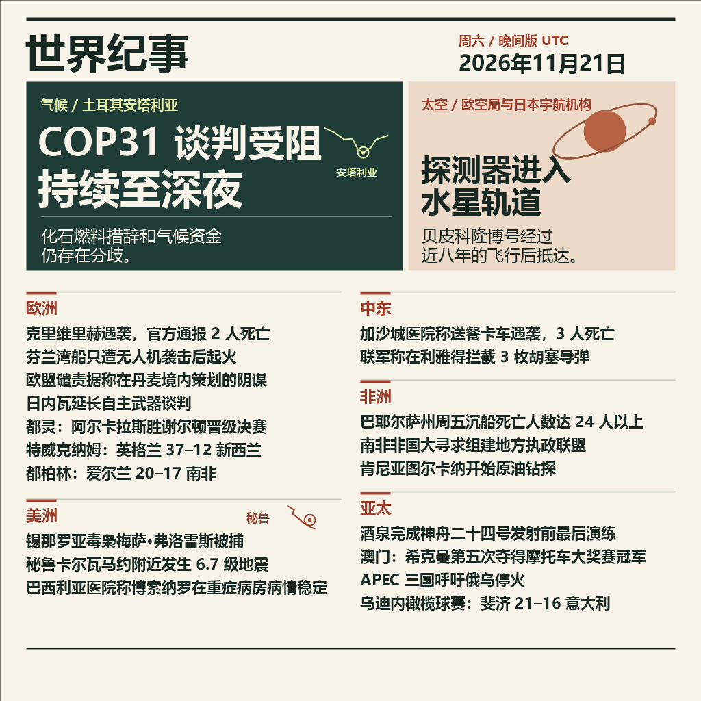

# 世界纪事 / The World Ledger · 21 November 2026

[中文](#中文) · [English](#english)

[中文版 / Chinese](entry.zh.png) · [English edition / 英文版](entry.png)

## 中文

### 第一次使用

1. 想做其他日期或今天的新闻图，请[打开每日新闻制图](https://xialin99.github.io/makefun-news-studio/)，选择日期并下载 PNG。
2. 想看这期参赛原稿，打开 [中文版](entry.zh.png) 或 [英文版](entry.png)。报道出处可查 [中文来源表](SOURCES.zh.md)。

2026 年 11 月 21 日世界新闻晚版，以 COP31 和水星探测为主版，共收录 21 条事件。

### 本地运行

直接打开 [中文版](entry.zh.png) 或 [英文版](entry.png)。在 Windows PowerShell 7 中运行 `./render.ps1` 生成中文版，添加 `-Language en` 生成英文版。 报道来源见 [中文来源表](SOURCES.zh.md)。

## English

### First use

1. To create a poster for today or another date, [open Daily News Studio](https://xialin99.github.io/makefun-news-studio/), select a date, and download a PNG.
2. To view this archived edition, open the [Chinese image](entry.zh.png) or [English image](entry.png). See the [source list](SOURCES.md) for the original reporting.

The 21 November evening edition brings together 21 dated events, led by COP31 and BepiColombo’s Mercury arrival.

### Run locally

Open the [Chinese edition](entry.zh.png) or the [English edition](entry.png). Run `./render.ps1` in PowerShell 7 on Windows. Add `-Language en` to render the English edition. See [SOURCES.md](SOURCES.md) for reporting sources.

[make.fun 赛事 / Original bounty](https://make.fun/bounty/news-image-20261121)

## 许可证 / License

MIT. See [LICENSE](LICENSE).

