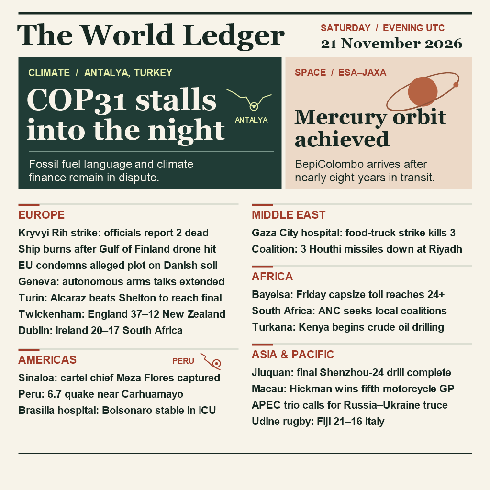

# The World Ledger · 21 November 2026

[中文](#中文) · [English](#english)

## 中文

2026 年 11 月 21 日世界新闻晚版，以 COP31 和水星探测为主版，共收录 21 条事件。

### 本地运行

直接查看 `entry.png`。Windows 下运行 `./render.ps1` 可重制图像，报道来源见 `SOURCES.md`。

## English

The 21 November evening edition brings together 21 dated events, led by COP31 and BepiColombo’s Mercury arrival.

### Run locally

Open `entry.png`, or run `./render.ps1` on Windows to regenerate it. See `SOURCES.md` for reporting and chronology.

[make.fun 赛事 / Original bounty](https://make.fun/bounty/news-image-20261121)

## 许可证 / License

MIT. See [LICENSE](LICENSE).

